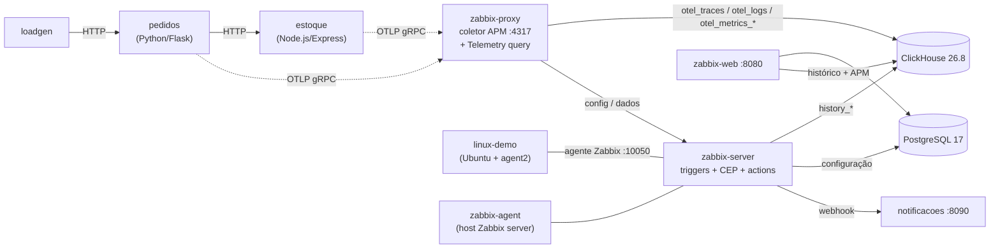

# Zabbix 8.0 LTS + ClickHouse — lab

Este lab sobe em um único `docker compose up` para revisar as novidades do **Zabbix 8.0**:

- **Histórico no ClickHouse:** server, frontend e API leem e gravam o histórico no ClickHouse. O PostgreSQL guarda só a configuração.
- **APM / OpenTelemetry:** o proxy recebe traces, métricas e logs via OTLP gRPC e grava tudo no ClickHouse.
- **Alertas de APM:** cada serviço vira um host com triggers de taxa de erro, latência, logs de erro e "parou de mandar telemetria".
- **CEP (Event processing):** regras que enriquecem eventos, agrupam causa e sintomas e detectam padrões.
- **Cenários de falha sob comando** (`./lab.sh`): erro, lentidão, serviço fora do ar e agente Linux fora.
- **Notificações:** os alertas chegam por webhook numa página do próprio lab.
- **Bootstrap automático:** tudo é configurado pela API na primeira subida, sem nenhum passo manual.

> ⚠️ Ambiente de **testes/review**. As senhas são padrão e as portas ficam expostas. Não use em produção.

## Arquitetura



| Serviço | O que é |
|---|---|
| `zabbix-server`, `zabbix-web` | Zabbix 8.0 (alpine) com o histórico no ClickHouse |
| `zabbix-proxy` | Proxy ativo: **coletor APM** (OTLP gRPC na porta 4317) e executor dos itens *Telemetry query* |
| `clickhouse` | ClickHouse 26.8 LTS: histórico + telemetria |
| `postgres` | PostgreSQL 17: só a configuração do Zabbix |
| `linux-demo` | "Servidor Linux" monitorado (Ubuntu + Zabbix agent 2) |
| `zabbix-agent` | Agente do próprio host *Zabbix server* |
| `pedidos`, `estoque` | Serviços de demo instrumentados com OpenTelemetry (traces, métricas, logs) |
| `loadgen` | Gera cerca de 1 pedido por segundo |
| `notificacoes` | Recebe os alertas do Zabbix por webhook e mostra numa página |
| `bootstrap` | Configura proxy, hosts, template, notificações e regras CEP pela API e depois encerra |

## Como subir

Requisitos: Docker com Compose v2 e uns 4 GB de RAM livres. Funciona em amd64 e arm64 (Apple Silicon).

```bash
git clone <url-deste-repo> zabbix8-lab
cd zabbix8-lab
docker compose up -d --build
```

A primeira subida leva alguns minutos (download das imagens e build dos serviços). Para acompanhar o bootstrap:

```bash
docker compose logs -f bootstrap
```

Quando aparecer `bootstrap concluído`, abra:

| | URL | Login |
|---|---|---|
| Zabbix | http://localhost:8080 | `Admin` / `zabbix` |
| Notificações recebidas | http://localhost:8090 | — |
| ClickHouse (Play UI) | http://localhost:8123/play | `zabbix` / `zabbix` |
| Serviço `pedidos` | http://localhost:8001/pedidos/novo | — |
| Serviço `estoque` | http://localhost:8002/health | — |
| OTLP gRPC (APM) | `localhost:4317` | — |

No estado normal **nenhum alerta fica aberto**. Os serviços têm só um ruído de fundo: cerca de 10% de pedidos "sem estoque" (HTTP 409, regra de negócio) e cerca de 5% de consultas um pouco lentas.

## Cenários de falha

```bash
./lab.sh caos erro       # ~50% das reservas do estoque falham (HTTP 500, exceção no span, log ERROR)
./lab.sh caos lento      # consultas do estoque levam ~3 s (o pedidos fica lento junto)
./lab.sh estoque-fora    # derruba o container do estoque (o pedidos passa a responder 503)
./lab.sh linux-fora      # derruba o agente do linux-demo
./lab.sh normal          # desfaz tudo
./lab.sh status          # estado atual + links
```

Acompanhe em **Monitoring → Problems**, **APM → Traces** e na página de notificações (http://localhost:8090).

| Cenário | O que deve aparecer | Tempo aproximado |
|---|---|---|
| `caos erro` | Logs ERROR e taxa de erro de spans acima de 5% no `estoque` (causa) e no `pedidos` (sintomas). No 3º alerta, a causa vira **Incidente: degradação nos serviços APM** e sobe de severidade | 1–3 min |
| `caos lento` | Duração de span alta nos dois serviços | 3–5 min |
| `estoque-fora` | **estoque parou de enviar spans** (High) + erros 503 no `pedidos`. Aqui o `pedidos` costuma virar a causa: os erros dele aparecem antes de o Zabbix notar a falta de telemetria do `estoque` | 1–3 min |
| `linux-fora` | *Linux: Zabbix agent is not available* no `linux-demo` | ~3 min |

Nenhum cenário consome CPU: as falhas são simuladas no código ou com o container parado. Não há cenário de CPU alta porque os containers enxergam a CPU da VM inteira do Docker: para disparar o alerta seria preciso ocupar todos os núcleos da máquina. Os containers de demo também têm limite de 0,5 CPU e 256 MB cada.

> A janela de causa/sintoma é de 10 min. Se você rodar um cenário logo depois do outro, os problemas do segundo viram sintomas da causa do primeiro. Para ver cada cenário isolado, espere uns 10 min entre eles.

## Alertas

| Host | Template | Triggers principais |
|---|---|---|
| `linux-demo` | *Linux by Zabbix agent* (padrão) | CPU, memória, load, disco, interfaces, agente indisponível |
| `estoque`, `pedidos` | **OpenTelemetry service by OTLP** (criado pelo bootstrap) | Taxa de erro de spans > 5%, duração de span, logs ERROR/FATAL/WARN, serviço sem telemetria |

O Zabbix 8.0 traz o template **Generic OpenTelemetry by OTLP**, que usa o novo tipo de item **Telemetry query** (consulta o ClickHouse direto, executado pelo proxy). Só que ele **não filtra por serviço**: cada item soma a telemetria de todas as aplicações. Por isso o bootstrap deriva dele o template *OpenTelemetry service by OTLP*, que:
- adiciona o filtro `ServiceName = {$OTLP.SERVICE.NAME}` em todos os itens *Telemetry query*;
- reduz as janelas de duração de 5 para 2 min (para o lab reagir mais rápido);
- inclui o trigger **"serviço sem telemetria"**: última coleta sem spans, num serviço que mandou spans nos últimos 30 min.

Cada host de APM é monitorado pelo proxy e tem a macro `{$OTLP.SERVICE.NAME}` com o `service.name` do OpenTelemetry. O `estoque` coleta a cada 30 s e o `pedidos` a cada 2 min (veja o porquê em CEP, abaixo).

**Notificações:** o bootstrap cria o media type **Lab webhook**, uma mídia para o usuário Admin e a action **Lab: notificar webhook** (grupos *APM services* e *Linux servers*). Os alertas aparecem em http://localhost:8090.

## CEP — Event processing

Fica em **Data collection → Event processing**. O Zabbix 8.0 já vem com 6 regras de exemplo, todas desligadas. O bootstrap cria 4 regras para o cenário do lab, nesta ordem de execução:

| Regra | Janela | O que faz |
|---|---|---|
| **Lab: enriquecer eventos dos serviços APM** | nenhuma | Adiciona a tag `time: plataforma` em todo evento do grupo *APM services* |
| **Lab: pedidos é crítico para o negócio** | nenhuma | Eventos com a tag `servico: pedidos` sobem 1 nível de severidade e ganham `impacto: cliente` |
| **Lab: incidente com vários alertas** | *pattern match*, 5 min | Script JS: com 3 ou mais problemas na janela, o primeiro é renomeado para **"Incidente: degradação nos serviços APM (3+ alertas em 5 min)"**, sobe 1 nível de severidade e a janela reinicia |
| **Lab: falha em cascata (causa e sintomas)** | causa/sintoma, 10 min | O primeiro problema da janela vira a **causa** e os seguintes viram **sintomas** dele (tags `cep: causa` / `cep: sintoma`) |

Comportamentos observados que valem para o review:
- **A ordem das regras importa.** Depois que a regra de causa/sintoma marca um evento como sintoma, as regras seguintes não recebem mais esse evento. Com o *pattern match* depois dela, a janela dele nunca chegava a 3 eventos. Por isso ele vem antes.
- **"Clone" não funcionou com triggers de problema único** (o padrão, e o caso de todos os triggers do template OTel). Nos testes, *clone first/last event* só gerou a cópia quando o trigger do evento de origem já estava em OK. Com o problema ainda aberto, o padrão era reconhecido (a janela fechava), mas a cópia não aparecia, sem erro na regra nem no log do server. Por isso a regra do lab renomeia e escala o primeiro evento em vez de clonar.
- **Causa e sintoma é por ordem de chegada**, não por dependência. Por isso o `estoque` (a dependência) coleta a cada 30 s e o `pedidos` a cada 2 min: assim a falha do estoque é detectada antes do reflexo dela no pedidos. Com a mesma frequência, o `pedidos` às vezes chega primeiro e vira a "causa".
- **A notificação sai antes do *pattern match* agir.** O PROBLEM da causa chega com o nome e a severidade originais. O "Incidente" e a severidade nova só aparecem na tela e no RESOLVED.
- **Sintomas não notificam enquanto são sintomas.** No `caos erro`, 4 problemas geraram 1 notificação, a da causa. Quando cada sintoma se resolve, chegam o PROBLEM e o RESOLVED dele juntos.
- A janela de causa/sintoma continua aberta depois que a causa se resolve. Qualquer evento que chegar dentro dos 10 min ainda vira sintoma.
- O `{EVENT.CAUSE.ID}` só é resolvido em sintomas. Em eventos causa, a macro chega como `*UNKNOWN*`.

## O que mais explorar

- **APM → Traces:** abra um trace do `pedidos` para ver a árvore de spans passando pelo `estoque`. Com `caos erro`, os spans com exceção ficam marcados.
- **APM → Logs** e **APM → Metrics:** logs correlacionados com o trace (TraceId/SpanId), métricas automáticas (HTTP, runtime do Node/V8) e de negócio (`pedidos_criados`, `pedido_valor`, `reservas`).
- **Administration → Proxies → zabbix-proxy → aba APM:** *APM data collection*, quota de mensagens e atributos extras.

Para consultar os dados direto no ClickHouse (http://localhost:8123/play):

```sql
-- traces que passaram pelos dois serviços
SELECT TraceId, groupUniqArray(ServiceName) AS servicos, count() AS spans
FROM zabbix.otel_traces GROUP BY TraceId HAVING length(servicos) = 2 LIMIT 10;

-- histórico numérico do Zabbix (o antigo par clock + ns virou clock_ns DateTime64(9))
SELECT * FROM zabbix.history ORDER BY clock_ns DESC LIMIT 10;
```

### Mandando telemetria de outra aplicação

Qualquer app com OpenTelemetry pode mandar dados para o proxy:

```bash
export OTEL_EXPORTER_OTLP_ENDPOINT=http://localhost:4317
export OTEL_EXPORTER_OTLP_PROTOCOL=grpc
export OTEL_SERVICE_NAME=minha-app
```

Para ter alertas dela, crie um host monitorado pelo `zabbix-proxy` com o template *OpenTelemetry service by OTLP* e a macro `{$OTLP.SERVICE.NAME}=minha-app`.

## Pegadinhas do Zabbix 8.0.0 encontradas na montagem

1. **ClickHouse 26.8 ou mais novo, na prática.** O server exige no mínimo 26.3 e se recusa a subir com versões anteriores. Mas o proxy envia os timestamps do APM como Unix com fração (`1793971405.260000000`), formato que o ClickHouse 26.3 não aceita. O proxy usa *async insert* sem esperar confirmação, então **os dados são descartados em silêncio**: o proxy não loga erro nenhum. O erro só aparece em `system.asynchronous_insert_log`.
2. **O APM precisa ser ligado por proxy.** Com `StartAPMCollector=1` o proxy inicia o *apm manager*, mas só abre a porta 4317 depois que **APM data collection** é habilitado no cadastro do proxy (`proxy.update` → `apm.data_collection_status: 1`). O APM é recebido só pelo proxy: o server não tem coletor OTLP.
3. **O template *Generic OpenTelemetry by OTLP* não separa serviços.** Os itens não filtram por `ServiceName`, então um host com esse template soma a telemetria de todas as aplicações (veja [Alertas](#alertas)).
4. **A configuração do ClickHouse mudou.** Agora existe `HistoryProvider=clickhouse;...` e `TelemetryProvider=clickhouse;...`. O `HistoryStorageURL` ficou *deprecated*. Nas imagens Docker as variáveis são `ZBX_HISTORYPROVIDER_0` e `ZBX_TELEMETRYPROVIDER_0`, cada uma com um objeto JSON. A forma `ZBX_HISTORYPROVIDERS` dá erro. Com `ZBX_*_0_SCHEMA='{"create":true}'` o entrypoint cria as tabelas.
5. **API:** `hostinterface.update` foi removido. As interfaces agora são alteradas via `host.update`. Na API `ceprule.create`, o `formulaid` das condições só é aceito com `evaltype` 3 (expressão customizada).
6. **`DebugLevel=4` no proxy 8.0.0 causa segfault** (signal 11) na subida.
7. **Triggers de ausência em cima do template OTel:** os itens de contagem de spans e logs usam *Discard unchanged with heartbeat 1h*. Com o serviço fora, só o primeiro 0 é gravado, então expressões como `max(...,#2)=0` nunca se cumprem. Use `last()`.
8. **OpenTelemetry JS 3.x (não é do Zabbix):** a API de logs saiu do `@opentelemetry/api-logs` e foi para o `@opentelemetry/api`. Com o pacote antigo, os logs simplesmente não são enviados.

## Comandos úteis

```bash
docker compose ps                    # status
docker compose logs -f zabbix-proxy  # logs do coletor APM
docker compose down                  # para (mantém os dados)
docker compose down -v               # para e apaga tudo (volta ao zero)
```

## Estrutura

```
docker-compose.yml          # toda a stack
lab.sh                      # cenários de falha
bootstrap/bootstrap.py      # configuração via API (idempotente): proxy, hosts, template, notificações, CEP
services/pedidos/           # serviço Python/Flask + OpenTelemetry
services/estoque/           # serviço Node.js/Express + OpenTelemetry (com modo caos)
services/notificacoes/      # receptor dos webhooks do Zabbix
```

As imagens do Zabbix usam a tag `8.0-alpine-latest`, que acompanha os patches da série 8.0. As dependências dos serviços de demo estão com versões fixadas.
